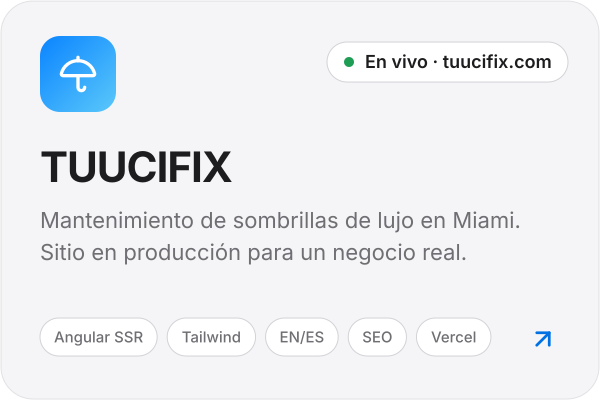
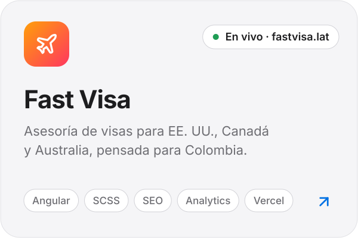
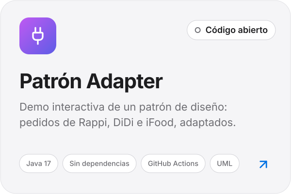
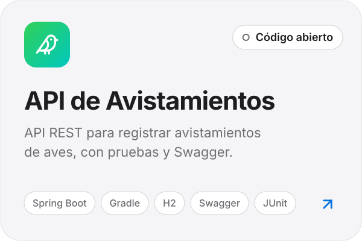
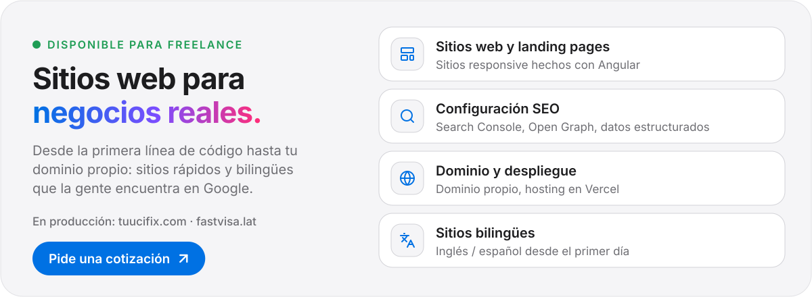

  <a href="https://github.com/Chocax">English</a>&nbsp;&nbsp;·&nbsp;&nbsp;<b>Español</b>

<picture><source media="(prefers-color-scheme: dark)" srcset="assets/es/header-dark.svg"></picture>

  Soy estudiante de Ingeniería de Sistemas en la <b>Universidad El Bosque</b>. Lo que más me gusta es el <b>backend</b>: APIs, bases de datos y, últimamente, las <b>redes de computadores</b>. 
  También desarrollo y despliego sitios web para negocios reales, desde la primera línea de código hasta el dominio propio.

 

<picture><source media="(prefers-color-scheme: dark)" srcset="assets/es/title-work-dark.svg"></picture>

  <a href="https://www.tuucifix.com"><picture><source media="(prefers-color-scheme: dark)" srcset="assets/es/project-tuucifix-dark.svg"></picture></a>
  <a href="https://fastvisa.lat"><picture><source media="(prefers-color-scheme: dark)" srcset="assets/es/project-fastvisa-dark.svg"></picture></a>

  <a href="https://github.com/Chocax/patron-adapter-grupo5"><picture><source media="(prefers-color-scheme: dark)" srcset="assets/es/project-adapter-dark.svg"></picture></a>
  <a href="https://github.com/Chocax/Api-Rest-Avistamientos-Ejemplo"><picture><source media="(prefers-color-scheme: dark)" srcset="assets/es/project-avistamientos-dark.svg"></picture></a>

 

<picture><source media="(prefers-color-scheme: dark)" srcset="assets/es/title-freelance-dark.svg"></picture>

  <a href="mailto:santipinzonv@gmail.com?subject=Cotizaci%C3%B3n%20sitio%20web"><picture><source media="(prefers-color-scheme: dark)" srcset="assets/es/freelance-dark.svg"></picture></a>

 

<picture><source media="(prefers-color-scheme: dark)" srcset="assets/es/title-stack-dark.svg"></picture>

<picture><source media="(prefers-color-scheme: dark)" srcset="assets/es/stack-dark.svg"></picture>

  

<picture><source media="(prefers-color-scheme: dark)" srcset="assets/es/title-now-dark.svg"></picture>

<picture><source media="(prefers-color-scheme: dark)" srcset="assets/es/now-dark.svg"></picture>

  

<picture><source media="(prefers-color-scheme: dark)" srcset="assets/es/title-contact-dark.svg"></picture>

  <a href="mailto:santipinzonv@gmail.com"><picture><source media="(prefers-color-scheme: dark)" srcset="assets/es/contact-email-dark.svg"></picture></a>
  <a href="mailto:spinzonv@unbosque.edu.co"><picture><source media="(prefers-color-scheme: dark)" srcset="assets/es/contact-university-dark.svg"></picture></a>
  <a href="https://www.instagram.com/spinzonv"><picture><source media="(prefers-color-scheme: dark)" srcset="assets/es/contact-instagram-dark.svg"></picture></a>

 

  Hecho en Bogotá 🇨🇴

