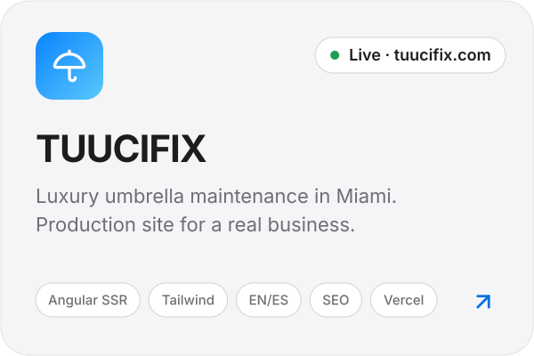
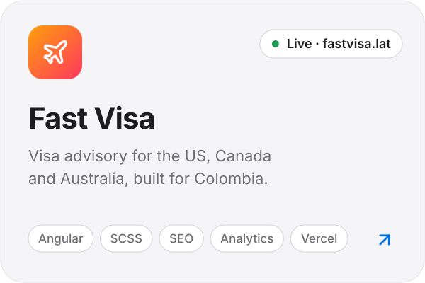
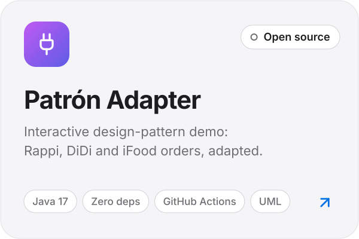
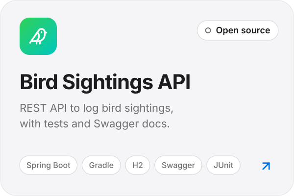
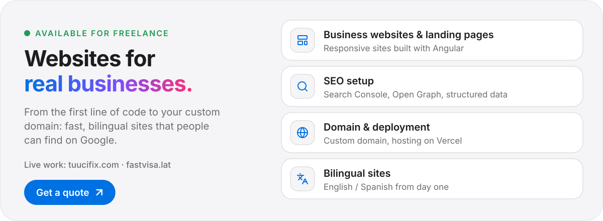

<picture>
  <source media="(prefers-color-scheme: dark)" srcset="assets/header-dark.svg">
  
</picture>

  I’m a Systems Engineering student at <b>Universidad El Bosque</b> who enjoys the <b>backend</b> side of things: APIs, databases and, lately, <b>computer networks</b>. 
  I also build and ship websites for real businesses, from the first line of code to the custom domain.

<b>🇨🇴 Leer en español</b>

 

  Soy estudiante de Ingeniería de Sistemas en la <b>Universidad El Bosque</b>, en Bogotá. Lo que más me gusta es el <b>backend</b>: APIs, bases de datos y, últimamente, las <b>redes</b>, área en la que me estoy certificando con Cisco.
  También desarrollo y despliego sitios web para negocios reales, desde el código hasta el dominio propio.

 

<picture>
  <source media="(prefers-color-scheme: dark)" srcset="assets/title-work-dark.svg">
  
</picture>

  <a href="https://www.tuucifix.com"><picture><source media="(prefers-color-scheme: dark)" srcset="assets/project-tuucifix-dark.svg"></picture></a>
  <a href="https://fastvisa.lat"><picture><source media="(prefers-color-scheme: dark)" srcset="assets/project-fastvisa-dark.svg"></picture></a>

  <a href="https://github.com/Chocax/patron-adapter-grupo5"><picture><source media="(prefers-color-scheme: dark)" srcset="assets/project-adapter-dark.svg"></picture></a>
  <a href="https://github.com/Chocax/Api-Rest-Avistamientos-Ejemplo"><picture><source media="(prefers-color-scheme: dark)" srcset="assets/project-avistamientos-dark.svg"></picture></a>

 

<picture>
  <source media="(prefers-color-scheme: dark)" srcset="assets/title-freelance-dark.svg">
  
</picture>

  <a href="mailto:santipinzonv@gmail.com?subject=Freelance%20website%20inquiry"><picture><source media="(prefers-color-scheme: dark)" srcset="assets/freelance-dark.svg"></picture></a>

 

<picture>
  <source media="(prefers-color-scheme: dark)" srcset="assets/title-stack-dark.svg">
  
</picture>

<picture>
  <source media="(prefers-color-scheme: dark)" srcset="assets/stack-dark.svg">
  
</picture>

  

<picture>
  <source media="(prefers-color-scheme: dark)" srcset="assets/title-now-dark.svg">
  
</picture>

<picture>
  <source media="(prefers-color-scheme: dark)" srcset="assets/now-dark.svg">
  
</picture>

  

<picture>
  <source media="(prefers-color-scheme: dark)" srcset="assets/title-contact-dark.svg">
  
</picture>

  <a href="mailto:santipinzonv@gmail.com"><picture><source media="(prefers-color-scheme: dark)" srcset="assets/contact-email-dark.svg"></picture></a>
  <a href="mailto:spinzonv@unbosque.edu.co"><picture><source media="(prefers-color-scheme: dark)" srcset="assets/contact-university-dark.svg"></picture></a>
  <a href="https://www.instagram.com/spinzonv"><picture><source media="(prefers-color-scheme: dark)" srcset="assets/contact-instagram-dark.svg"></picture></a>

 

  Hecho en Bogotá 🇨🇴 · Made in Bogotá

